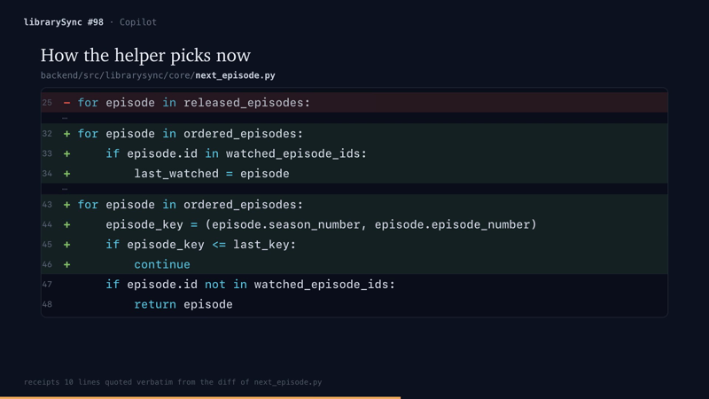
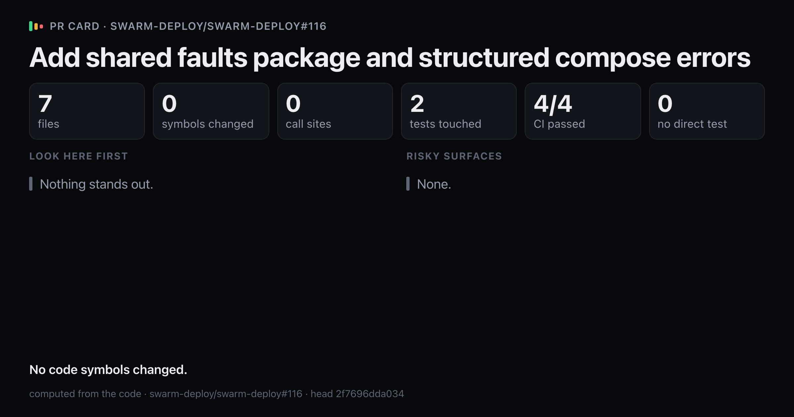
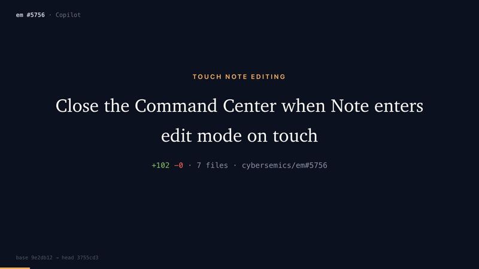
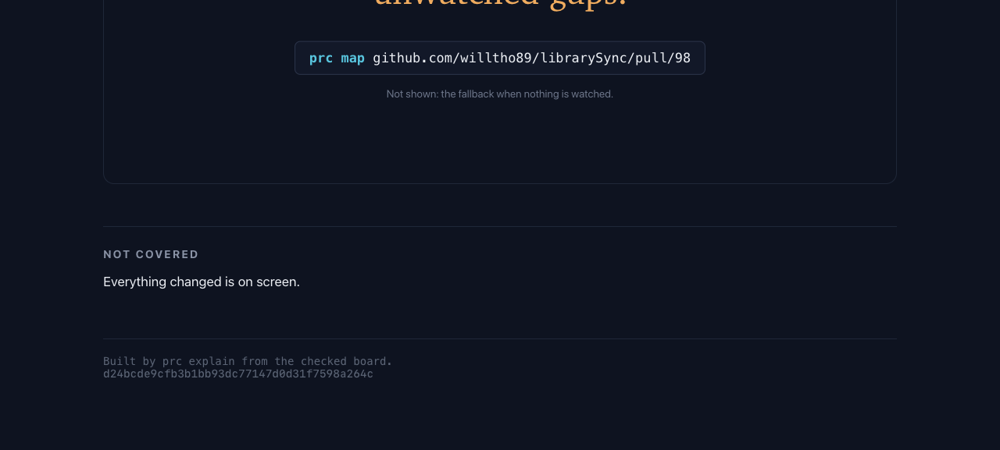
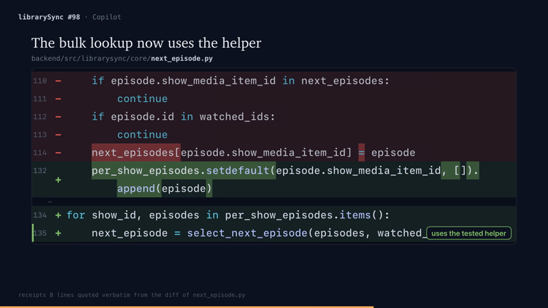
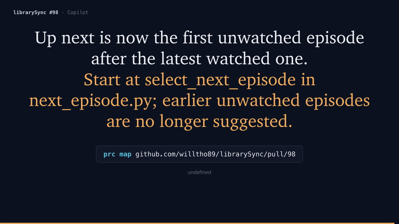
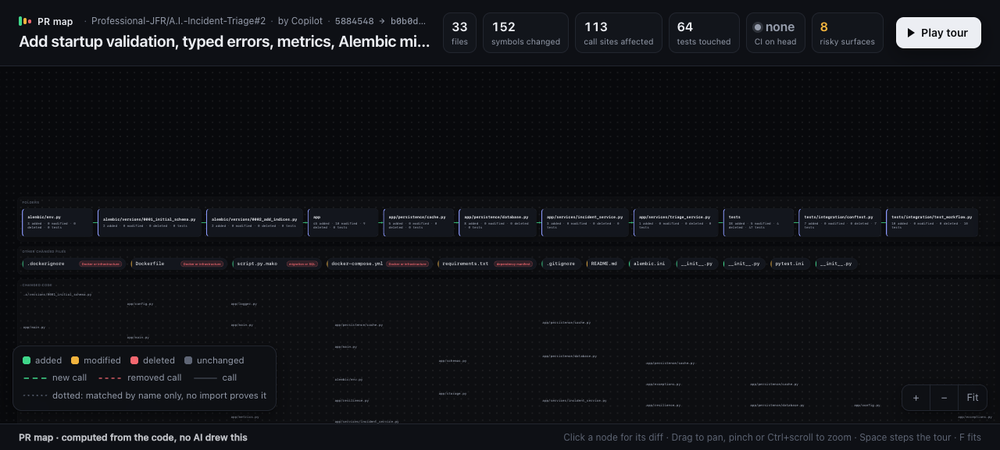

# Release readiness, 2026-10-08

## Summary

prc is not ready to release as a pull request visualizer. On one Mac, a fresh clone installs and runs on public pull requests that the project has never seen. On those pull requests, prc prints statements that the diff contradicts. No evidence shows that people find the output useful. The public repository has no license.

This report checks seven conditions on a fresh clone of public `main` at `eeaba4b`. It lists each defect with a pull request and a way to see it again. It ends with the work that a release needs and the decisions that belong to the owner.

[RELEASE.md](RELEASE.md) (2026-10-07) is the earlier status. [PUBLISH.md](PUBLISH.md) is the operator checklist. The decision trail for this report is [readiness-2026-10-08.tsv](../../.audit/readiness-2026-10-08.tsv). Each row records one decision, its reason, its evidence and its result.

## Verdict by check

Results are measured. Text marked "inferred" is a conclusion drawn from measured facts.

| Check | Verdict | Evidence |
|---|---|---|
| 1. Public install | Verified on one Mac | In the logged probe run, the clone took 26 s. `uv sync --extra video` with an empty uv cache took 22 s. `prc doctor` lists each tool and marks Kokoro missing. The offline example writes all five outputs in 30 to 36 s. The check used a cached Chromium, so `playwright install chromium` is untested. |
| 2. Contributor checks on a fresh clone | Not verified | Lint, format, mypy and build pass. pytest reports 571 passed and 1 failed (D16). |
| 3. Unseen live pull requests, no token | Verified | 6 of 6 runs exit 0 in 6 to 26 s. A second probe run repeated two of them in 12 s and 35 s. None of the six repositories appears in `eval/`, `docs/` or `tests/`. |
| 4. Agent board workflow | Verified, with friction | Two fresh agents had only the installed instructions. Both made a checked board and all five outputs. They logged 20 and 15 problems with the instructions. |
| 5. Output accuracy | Not verified | On 2 of 6 boardless runs, prc's own text contradicts the diff and misleads a reviewer. Both agent output sets also ship such text. The map and the card disagree on 6 of 6. |
| 6. Usefulness evidence | Not verified | Two scored runs exist, and neither meets all of the frozen targets. No human answer exists. The current code has no scored run. |
| 7. Legal and distribution | Not verified | There is no license and no CI. The PyPI name `prc` is taken. Private paths are public. |

All six pull requests come from GitHub's Copilot coding agent, and all six are merged. Each run time below comes from the first probe run.

| Pull request | Language | Size | Run time |
|---|---|---|---|
| [willtho89/librarySync#98](https://github.com/willtho89/librarySync/pull/98) | Python | +72 -7, 2 files | 8 s |
| [jsilvanus/saarnavideo#51](https://github.com/jsilvanus/saarnavideo/pull/51) | TypeScript | +862 -318, 16 files | 8 s |
| [larsritlandswo/tryangle#2](https://github.com/larsritlandswo/tryangle/pull/2) | Python | +1342 -17, 10 files | 6 s |
| [swarm-deploy/swarm-deploy#116](https://github.com/swarm-deploy/swarm-deploy/pull/116) | Go | +313 -16, 7 files | 7 s |
| [Professional-JFR/A.I.-Incident-Triage#2](https://github.com/Professional-JFR/A.I.-Incident-Triage/pull/2) | Python | +1988 -627, 33 files | 7 s |
| [cybersemics/em#5756](https://github.com/cybersemics/em/pull/5756) | TypeScript | +109 -3, 7 files | 26 s |

## What works

- A fresh clone installs from README.md on this Mac, with an empty uv cache. `prc doctor` names each missing tool.
- prc fetches unseen public pull requests in 6 to 35 s, with no token and no setup.
- `board check` errors are exact. A wrong quote prints the real text of the line, and one edit fixed it. A scene over the row limit names the scene and the limit.
- Both final agent videos are readable at 800 px. Each states its main change in line with the diff. Trial A shows the old pick and the new pick on the fixture from the pull request's own test.
- With the macOS `say` voice, the offline example has a non-silent audio track. The video is 37.76 s, 2.2% over prc's prediction of 36.93 s.



## Defects

A defect is output that a user sees and that the diff, or other prc output, contradicts. In each repro, "explain URL" means `uv run prc explain --source URL --voice none --out /tmp/prc-check` in a clone.

### Statements that mislead a reviewer

**D1. Go changes show as no change.** swarm-deploy#116 changes 7 Go files. The card says "Nothing stands out" and "No code symbols changed", above the line "computed from the code". The comment has a Mermaid block with no nodes. Nothing says that prc cannot parse Go. *Repro.* Explain the pull request, then open `card.png` and `comment.md`.



**D2. Handlers in TypeScript object literals are invisible.** em#5756 puts its behavior in handlers inside object literals, in `src/commands/note.ts` (+6) and `src/commands/openCommandCenter.ts` (+4). The map finds one changed symbol, `CommandCenter` (+2). The comment's "Look here first" starts at `CommandCenter`. The agent's video says "Start at onComplete in note.ts". *Repro.* Explain em#5756, then read `comment.md`.

**D3. Browser tests count as no test.** em#5756 adds 72 lines of puppeteer tests that drive the Command Center. The map says "0 tests touched". The comment lists `CommandCenter` under "Not covered by tests". *Repro.* Use the run from D2.

**D4. Dependency patches are not marked risky.** em#5756 patches the `react-modal-sheet` library in `.yarn/patches` and changes `yarn.lock`. The comment says "No risky surfaces." *Repro.* Use the run from D2.

**D5. Opaque files count as zero lines.** `map.json` gives `docs/commands.md` and `yarn.lock` 0 added and 0 removed lines. GitHub reports +5 -1 and +2 -2. So the video title card says "+102 -0 · 7 files", and GitHub says +109 -3. *Repro.* Use the run from D2, then read `files` in `map.json`.



**D6. The map and the card print different numbers under one label.** Both show "tests touched" for the same run.

| Pull request | Map | Card |
|---|---|---|
| librarySync#98 | 5 | 1 |
| saarnavideo#51 | 0 | 1 |
| tryangle#2 | 3 | 2 |
| swarm-deploy#116 | 0 | 2 |
| A.I.-Incident-Triage#2 | 64 | 7 |
| em#5756 | 0 | 1 |

Call sites also differ on A.I.-Incident-Triage#2, with 113 on the map and 128 on the card. The map counts test symbols, and the call sites of code symbols only (`src/prc/presentation/map_assets/map.js:133-136`). The card counts test files, and the call sites of all changed symbols (`src/prc/presentation/card.py:93-94`). *Repro.* Read the `#stats` row of `map.html` in a browser. Then print the card's numbers for the same map.

```bash
uv run python -c 'import json, sys; from prc.presentation.card import compute_stats; print(compute_stats(json.load(open(sys.argv[1]))))' <out>/map.json
```

**D7. The walkthrough says that everything is on screen.** On librarySync#98, the agent's video shows 10 of the 30 added code lines. Its outro says "Not shown: the fallback when nothing is watched." Directly below, `doc.html` says "Everything changed is on screen." That sentence comes from `src/prc/explainer/doc.py:164`. It appears when the board leaves out no file and no symbol (inferred from both output sets).



**D8. An unchanged test shows as modified.** On librarySync#98, an added decorator line sits next to `test_mark_next_episode_watched_creates_watched_event_and_internal_outbox_job`. prc marks that test modified, so the card says "7 symbols changed".

### The agent loop

**D9. The check passes a board that the render rejects.** A diff scene that lists a blank added line passes `prc board check` with "51 receipts verified". `prc explain` then exits 1 with "join gate failed for diff scene 4: [CUT_NOT_SPACES] row 133". *Repro.* Add a blank added line to a diff scene. Run `prc board check`, then `prc explain --board`.

**D10. Layout warnings miss a note that covers code.** A diff note on line 135 hides the end of the line. `run.json` reports `layout_warnings: []`. Trial B's report says that its notes overlapped the next box, with the same empty list. This assessment did not reproduce that case.



**D11. A missing `fine` field prints "undefined".** The guide shows the outro field `fine` only in an example. A board without it passes the check with "41 receipts verified". The outro then prints "undefined".



**D12. The length is known only after a render.** The guide says "45 to 75 seconds in total. `check.py` prints an estimate." `prc board check` prints no estimate. Both agents' first videos broke the limit, at 85.8 s and 82.5 s. All six successful trial renders used `--voice none` and logged an estimate. Each estimate was 10 to 19 s short, which is 16% to 23% of the real length.

**D13. The installed guide names files that users do not have.** `prc board guide` prints `src/prc/explainer/assets/BOARD.md`. The guide says "Run these from the `explainer` directory" and lists `python3 show.py`, `find.py`, `check.py` and `build.py`. It names `boards/mdp17b.json` as the reference board. It says to look at stills "with the Read tool". An installed user has `prc board` commands instead, and no command previews stills. So each preview costs a full render. The guide's title example uses the kicker "Open pull request", and trial A copied it onto a merged pull request.

**D14. Claude and Codex users get different instructions.** The Codex section in `src/prc/skill/__init__.py:51` says that prc "checks every fact". Its own step 4 says that titles, subtitles and notes are unchecked. The Claude skill, `src/prc/skill/SKILL.md`, says that prose is unchecked. The Codex output list leaves out `doc.html`, `card.png` and `comment.md`. The Claude skill lists two different sets of "5 files" in steps 7 and 9.

### Setup and errors

**D15. GitHub errors give a misleading traceback.** Without a token, GitHub allows 60 API calls per hour. A boardless run uses about 4 calls, so about 15 runs fit in an hour (inferred). In the probe, two runs and one missing pull request used 11 calls, and the missing one made 3 tries. When the limit ran out, GitHub answered 403 "API rate limit exceeded". `prc explain` then exited 1 with a 22-line Python traceback. It ends in `SourceError: enumerate must run before repo_path`, and it names neither the rate limit nor `GITHUB_TOKEN`. A missing pull request gives the same traceback. `src/prc/capture.py:49-51` stores the real HTTP error as a capture gap, and no message shows it. `prc doctor` reports "GITHUB_TOKEN unset" and does not say what that limits. *Repro.* Explain `https://github.com/komaksym/prc/pull/999999`. Or wait until `curl -s https://api.github.com/rate_limit` shows `remaining` 0, then explain any public pull request without a token.

**D16. The release test needs a warm uv cache.** `tests/test_release_package.py:82` fails with the probe's fresh uv cache. Line 76 installs the built wheel with `uv pip install --offline`, and uv reports "pygments was not found in the cache". A clean CI runner would fail the same way (inferred).

**D17. Large maps are hard to read.** A 36-symbol map repeats identical truncated labels. A 152-symbol map is unreadable at 1280 px.



### Minor

- The card prints "1 tests touched", "1 symbols changed" and "1 call sites". The map prints "none CI on head".
- A boardless run prints `"check_passed": false`, which reads like a failure.
- prc writes its git cache to `artifacts/store/git-cache/` under the current folder, outside `--out`.
- With `--voice none`, the video has a silent AAC track. `.agents/skills/verify/features/explain.md:33` says that such a video has no audio stream.
- `prc board coverage` prints "code 30/30" for added lines in files on screen. Both agents flagged it as a false sign of full line coverage.

## Agent trials

Each trial agent got the pull request URL, the installed instructions and a work folder. It had no access to the prc repository docs or source. Both agents used `--voice none` and no token.

| | Trial A | Trial B |
|---|---|---|
| Model | claude-opus-5-5 | gpt-6.1-sol |
| Instructions | Claude skill (`SKILL.md`) | Codex section in `AGENTS.md` |
| Pull request | librarySync#98, Python | em#5756, TypeScript |
| Check runs until the first pass | 2 (5 in total) | 2 (4 in total) |
| Board renders | 4, and one failed after a passing check (D9) | 3 |
| Start to final render | 12 min 50 s | 16 min 8 s |
| First video | 85.8 s | 82.5 s |
| Final video | 73.17 s | 65.08 s |
| Instruction problems logged | 20 | 15 |

Both times include 1 to 2 minutes of idle time from one interruption. Both final videos are 1920x1080 at 30 fps.

prc does not check group titles, subtitles or notes. Trial B's final "after" scene keeps the subtitle "kept open by the selection" beside the note "closed on touch". Both agents' reports list further overclaims in their own narration. The decision trail lists the local paths of both reports.

## Usefulness evidence

The repository's eval asks an agent reader 96 questions per output, with that output alone. Two runs were scored. Neither meets all of the frozen targets.

| Output | [2026-10-06-full](../../eval/runs/2026-10-06-full/scoreboard.md) | [2026-10-08-release-check](../../eval/runs/2026-10-08-release-check/scoreboard.md) | Target |
|---|---|---|---|
| Walkthrough (C4) | 69.8% | 46.9% | 85% |
| Muted video frames (C3) | 46.9% | 38.5% | 70% |
| Comment (C2) | 25.0% | 35.4% | 60% |
| Card (C1) | 20.8% | 35.4% | 35% |
| First map screen (C5) | 17.7% | 13.5% | none set |
| Wrong answers, all outputs | 44 | 35 | 0 |

Each output must also score 30 points above the baseline, which means 62.3% or more. The baseline reader saw only the title and description, and scored 32.3%. Only the walkthrough in the 2026-10-06-full run met that target, at 69.8%. In the 2026-10-08 run, no output met it. The card met its own 35% target once, at 35.4% in the 2026-10-08 run.

[ARCHIVED.md](../../eval/runs/ARCHIVED.md) lists a rebaseline, two fix rounds and a release candidate after the first scored run. None of them finished scoring. The current code has no scored run, so the numbers above describe older output ([STATUS.md](../mvp/STATUS.md)).

All three human sheets in [eval/human/](../../eval/human/) are blank. No person has said whether they would put prc's output on a pull request. The comparison sheet against CodeRabbit and Coldtea PR Lens is blank too.

Both trial agents judged that a new reviewer would understand the main change from their video and walkthrough. The frame review for this report agrees that both videos state the main change in line with the diff. This is agent judgment. It is not evidence that people find prc useful.

**The premise of the fix rounds.** Each fix round tried to raise the same agent score. That score measures what a reader recalls from one output alone. A real reviewer reads the output next to the diff. So a higher score does not show that reviewers save time or catch more problems (inferred). A 30-minute session with three outside developers, on their own pull requests, measures that more directly.

START-HERE.md makes "any target in `EVAL.md` that fails three fix rounds in a row" the owner's call. RELEASE.md counts only completed fix rounds, and the record has two scored runs. So the stop rule has not formally triggered. The falling walkthrough score gives the owner a reason to decide now (inferred).

## Legal and distribution

- **No license.** The repository has no LICENSE file, and GitHub's community profile reports none. Without a license, "no one may reproduce, distribute, or create derivative works from your work" ([GitHub Docs](https://docs.github.com/en/repositories/managing-your-repositorys-settings-and-features/customizing-your-repository/licensing-a-repository)).
- **Package name.** On PyPI, `prc` is "PRC 1.0.0", a Python Remote Console. On 2026-10-08, `prc-explain`, `pr-explain`, `prcard` and `prc-map` returned 404 on PyPI. The `prc` command can keep its name, because a console script name does not depend on the distribution name.
- **No CI.** The repository has no `.github/workflows`. GitHub's community health score is 28%.
- **Private paths.** `git grep -o` finds the author's home folder path 305 times in 44 tracked files. Of these files, 31 are under `eval/`, 8 under `docs/` and 4 under `.audit/`, and one is `START-HERE.md`. PUBLISH.md says that a history scan found no private path names. So that scan does not cover these paths (inferred).
- **Published before its own checklist.** The repository went public on 2026-10-08. PUBLISH.md step 1 says to keep `reports/` out or review each file first. Step 2 says to add a license. `reports/` is public, and `docs/` has no record of the review.
- **Size.** A clone is 165 MB. Of 2183 tracked files, 1855 are under `eval/`.
- **README.** It says that release is blocked, which is accurate. It has no output image. It calls the 2026-10-06-full scoreboard current, but the 2026-10-08 run is newer. Install needs a clone and `uv sync`.
- **Agent files.** `START-HERE.md`, `CLAUDE.md`, `PLANS.md` and `CONTEXT.md` sit beside README.md at the root. They are written for the author's agents.

## Competition

Each link below was opened on 2026-10-08, and the quoted text is on the page.

- **CodeRabbit.** Its walkthrough "includes a sequence diagram of the flow when the change has one" ([blog](https://www.coderabbit.ai/blog/introducing-overview)). Its config schema has `sequence_diagrams`, with the default `true` ([schema](https://raw.githubusercontent.com/coderabbitai/awesome-coderabbit/main/schema.v2.json)).
- **Greptile.** Its product page lists "sequence diagrams and flowcharts generated for every PR" ([CLI page](https://www.greptile.com/cli)).
- **Coldtea PR Lens.** It posts an animated architecture and data flow diagram as a pull request comment. New parts are green, changed parts amber and removed parts red. It offers a GitHub App, GitHub Action, CLI and agent skill ([GitHub App](https://github.com/apps/coldtea-pr-lens), [repository](https://github.com/coldteadotai/pr-lens)).

Diagrams on pull requests are common, and PR Lens is the closest match to prc's map (inferred). prc's own parts are the narrated video and the walkthrough. Their line receipts pass `board check`, and they run locally with no account. The eval scores and the defects above show that these parts are the least proven (inferred).

## What a release needs

1. **Stop false statements.** Fix D1 to D8. Say "language not supported" instead of "no change". Give the map and the card one stat function. Parse handlers in object literals. Count browser tests. Mark dependency patches and lockfiles as risky. Count lines in Markdown and lockfile diffs. Derive "Not covered" from the lines on screen.
2. **Make the agent loop honest.** Fix D9 to D14. Run the render's join gate inside `board check`. Print the length estimate in `board check`, and correct its shortfall. Detect notes that cover code. Require `fine`, or give it a default. Point the guide at `prc` commands, and add a stills preview. Generate the Claude and Codex instructions from one source.
3. **Explain failures.** Show GitHub's own error, such as a rate limit or a missing pull request. Make `prc doctor` say what an unset token limits (D15).
4. **Launch basics.** Make the release test pass on a clean cache (D16). Add CI that runs the verify command. Add an output image to README.md, and link the newest scoreboard. Remove the private paths.
5. **Measure usefulness with people.** Run the 30-minute session with three outside developers on their own pull requests. Record wrong statements, and whether each person would post the output. Then run three to five agent trials on outside developers' pull requests.

The owner decides these, per START-HERE.md and PUBLISH.md:

- the license;
- the PyPI name, for example `prc-explain`;
- whether `reports/`, `eval/` and the agent files stay public;
- what to do with the eval targets that keep failing.

## Verification of this assessment

The assessment worktree passes the repository's verify command on its warm uv cache:

```bash
uv run ruff check . && uv run ruff format --check . && uv run mypy && uv run pytest -q && uv build
```

Lint and format pass. mypy reports no issues in 97 source files. pytest reports 572 passed in 259.89 s. The wheel and source distribution build. This pass does not resolve the fresh-cache failure in D16.

`tests/test_e2e_explain.py` drives the real CLI and preserves its output under `artifacts/e2e/explain/`. The browser screenshots for this assessment sit under `artifacts/readiness/2026-10-08/`. The seven images in this report preserve the main findings in Git.

`bash -n scripts/probe-public.sh` passes. The probe also returned exit 1 when a planted missing pull request failed. No production dependency was added.

## How to rerun

[probe-public.sh](../../scripts/probe-public.sh) repeats checks 1 and 3. It clones the public repository and installs it as README.md says, with an empty uv cache. Then it runs `prc doctor`, renders the offline example and runs a boardless `explain` on each pull request URL. `results.tsv` gets the exit code and seconds of each step. `env.tsv` records the commit, the token state and the caches. The script exits 1 when any step fails.

```bash
bash scripts/probe-public.sh artifacts/readiness/<date> \
  https://github.com/willtho89/librarySync/pull/98 \
  https://github.com/cybersemics/em/pull/5756
```

- `PRC_REPO_URL` and `PRC_REF` select another repository or branch.
- Chromium must be available. Set `PLAYWRIGHT_BROWSERS_PATH` to an existing cache, or run `uv run playwright install chromium` once.
- Leave `GITHUB_TOKEN` unset to repeat check 3. The script warns when it is set. Without a token, expect about 15 live runs per hour (D15). For more, pass the token inline as `GITHUB_TOKEN="$(gh auth token)"`.
- For check 2, run the verify command from START-HERE.md in the clone that the probe keeps. Set `UV_CACHE_DIR` to the probe's cache to see D16.

## Limits of this assessment

- Most timings come from one run. The install and two pull requests ran twice.
- All runs used one Mac. No Linux or Windows host was tested.
- Agents judged accuracy against `gh pr diff`. No person checked it.
- The six pull requests are merged pull requests from one coding agent. They are not a random sample.
- `playwright install chromium` was not tested.
- Only the macOS `say` voice was tested, on the offline example. Kokoro was not tested, because its first use downloads model weights. START-HERE.md asks before such downloads. No person listened to the narration.
- The D9 and D10 repros ran after the rate limit was used up, so they passed a token inline.
