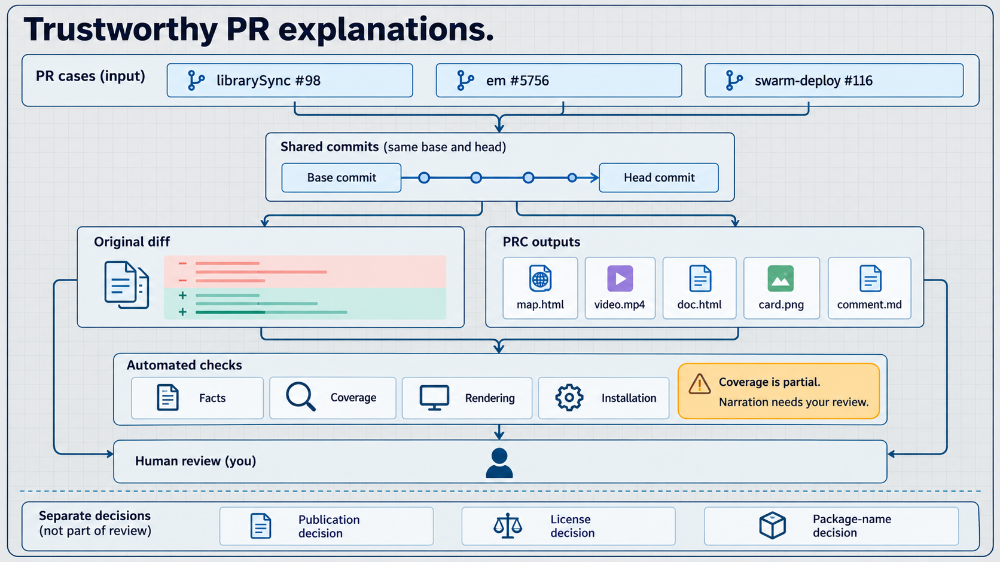

# Trustworthy PR explanation milestone

Summary. Final source 548d8ab passes clean-cache verification and the complete acceptance artifact inspection.
The assessment defects and seven final inspection defects have passing regression cases.
The user is the only human reviewer, and human acceptance is pending. Model reviews are supplemental defect checks.
Public release, license, package name, push and PR creation remain separate decisions.



Each PR has its own base and head pair. That pair matches between its original diff and its PRC outputs.
The figure describes the review method. The verification record below establishes its completion.

## What changed

Shared facts now supply the card, comment and map. Test counts mean changed test files.
Call counts and direct test evidence describe static analysis. They do not establish test coverage.
Unsupported languages are explicit. File-level output remains available for Go diffs.
TypeScript object handlers have distinct names and incoming call resolution.
Quoted properties retain their segment identity. Literal backslashes cannot create false test-call evidence.
Malformed key escapes do not crash indexing. Mermaid labels keep terminal bracket property names intact.
Git hunk alignment preserves unchanged symbols. Numstat counts treat filenames literally.
Lockfiles, dependency patches and browser tests receive the correct classification.

Coverage counts only changed code rows that finish their reveal before the settled frame.
It lists omitted lines and changes without available diff references.
Checks and rendering share the join validator. Actual narration timing is checked before encoding.
Notes move below code when necessary. Card labels wrap without clipping.
Text and columns determine wrapping. Syntax colours and change markers do not alter visual line breaks.
Required outro text and fine print finish before the settled frame.
Malformed scene collections fail with CLI receipts. The comment links only to a card image that exists. Long graph labels truncate at complete escape entities.
Deletion-only changes state the deletion and ask the reviewer to check remaining callers.
Installed agent instructions share one source. The guide uses installed preview and check commands.
Source failures preserve actionable GitHub errors without tracebacks.
Verification copies intended tracked or staged inputs and excludes unrelated experiments.

## Assessment regression cases

| Defect | Regression evidence |
| --- | --- |
| D1 | Unsupported Go reports analysis limits, not no changes. |
| D2 | Object-handler parsing, imported incoming calls and shadowing tests. |
| D3 | Browser-test classification and changed test-file counts. |
| D4 | Lockfile and dependency-patch risk classification. |
| D5 | Exact large-text and literal filename line counts. |
| D6 | Shared facts and browser/card/comment consistency checks. |
| D7 | Literal displayed-line coverage and missing-line walkthrough checks. |
| D8 | Original librarySync decorator revision and Git-aligned hunk regressions. |
| D9 | Blank context, empty diff and shared join validation regressions. |
| D10 | Real browser note placement and overlap checks. |
| D11 | Empty outro fine print and required reveal cues. |
| D12 | Silent duration, delayed replacements and actual fitted timestamp checks. |
| D13 | Installed commands and keys-only preview checks. |
| D14 | Canonical agent instruction installation checks. |
| D15 | CLI source-error regressions without misleading tracebacks. |
| D16 | Locked online installation from an empty cache and isolation regression. |
| D17 | Real dense-map group and member screenshots. |

## Defects found in the acceptance outputs

The first acceptance build at 79407d2 showed defects that the regression suite missed.
Each fix below has a test that failed before the fix and passes after it.

| Defect | Fix | Commit |
| --- | --- | --- |
| On em#5756, the third look-first entry covered the test-evidence block. | The card fits its lists in Chromium and shows "+N more". The evidence block keeps its size. | 013cbcc |
| Analysis limits replaced the direct-test verdict. | The card and the comment state both. The comment lists every unparsed path. | 013cbcc |
| The card always read "CI passed". | The CI statistic follows the check state, as the map does. | 013cbcc |
| Counts of one used plural labels. | Card and map labels are singular for one. | 013cbcc, 03daa33 |
| The card OCR test passed by accident. | The test uses tesseract sparse-text mode. | 013cbcc |
| Map symbol cards cut "no direct test evidence" mid-word. | The badge reads "no test evidence" and keeps its width. The full phrase shows on hover. | 03daa33 |
| Seven header statistics squeezed the head SHA to one character. | The PR name and author shrink before the SHAs and the GitHub link. | 03daa33 |
| The walkthrough did not say how many changed lines it shows. | It states "N of M changed lines are on screen." | cf52839 |
| test_e2e_cli deleted the proof images of other tests. | It removes only its own store and reviews folders. | 61df299 |
| The crowded-card test turned a fit failure into a skip. | It skips only when Chromium cannot launch. | 0476bb8 |

Refactor eada189 moved the test verdict into Facts.test_verdict, so the card and the comment read one value.
It changed no rendered card. card.png, card.html, comment.md, doc.html, board.json and map.json are byte-identical before and after it.
map.html differs only by the new summary.test_verdict field.

## Defects found by milestone and delta review

| Defect | Regression and correction |
| --- | --- |
| Quoted dotted properties collided with nested member paths. | Parser and map tests separate identities and reject false exact test edges. |
| Literal backslashes were parsed as escaped identifier syntax. | Index and compute_facts tests preserve bracket names and report missing direct test evidence. |
| Malformed Unicode escapes crashed indexing. | JavaScript, TypeScript and TSX cases complete indexing without ValueError. |
| Mermaid shortened a bracket property to a nonexistent name. | Rendered-comment tests preserve the terminal bracket name. |
| Wrapped rows overflowed the visible stage. | The checker and engine use diff_layout and reject overflow. A real browser shows fitting wrapped rows. |
| Syntax token boundaries changed wrapping between checking and rendering. | Wrapping uses plain text boundaries and preserves token styles. A real CLI regression rejects six overflowing assignment rows. |
| Outro cues could pass without finishing their reveals. | Estimated and fitted timing checks include the animation and delayed fine print. |
| A failed PNG card left an image reference and upload instruction. | The real explain pipeline retains card.html and omits the absent card.png from the comment. |
| Deleted-only changes had an unclear verdict. | Shared facts and comment tests state the deletion and retain the changed-symbol count. |
| Malformed scene and collection forms caused tracebacks. | Fourteen real CLI cases fail with exit code 2 and receipt messages. |

The red and green logs live under artifacts/trustworthiness/2026-10-09/regressions.
The audit reports record test-invocation corrections and environment failures separately from product regressions.

## Final inspection defects

The final image inspection and model review added D18 to D24.
The tests landed at cadf6f9 before the fixes at 548d8ab.
Against the original source, 14 cases failed as predicted and the partial-coverage control passed.
The corrected source passed all 15 cases in 6.17 seconds.

| Defect | Correction and proof |
| --- | --- |
| D18 | The verdict says "any" when every live production symbol lacks direct test evidence. The partial case retains "some". |
| D19 | Walkthrough prose renders paired backticks as code after escaping HTML. Real browser prose matches video captions. |
| D20 | Wrapped diff signs align with the first visual line. Measured offset changed from 90 pixels to zero. |
| D21 | Omitted removed lines list ascending line numbers before ascending added lines. |
| D22 | Receipt labels identify removed lines while retaining base and head commit links. |
| D23 | Cards and video outro lines render code names consistently. |
| D24 | Card and comment headlines use `show` text from a sentence with separate speech spelling. |

The Python caption rule lives in `src/prc/captions.py`. The browser parity test guards its JavaScript counterpart.
Proof is in `regressions/inspection-d18-d24-{red,green}.log`, `artifacts/e2e/caption-headlines` and `artifacts/e2e/caption-parity`.
The parent viewed both card captures, the outro, all three caption captures and the document scene.

Coverage counts only rendered changed diff rows that finish before the settled frame.
List quotes and other textual citations do not add to the on-screen line count.
This conservative rule can undercount visible quotations. The walkthrough still lists omitted changed lines.

## Final verification

scripts/verify-release.sh passed at 548d8ab from an empty uv cache. The proof is artifacts/release/verify/run-uVHho9.

- ruff check passed. ruff format checked 566 files. mypy passed on 104 source files.
- pytest ran 812 tests with 0 failures, 0 errors and 0 skips in 334.57 s.
- uv filled the empty cache. sync.log has 12 download lines.
- The installed wheel rendered the offline example outside the source checkout. The video is 1920x1080 and 41.008 s long. The browser checks logged no errors.
- prc doctor found Python 3.12.7, ffmpeg, Chromium and say. Kokoro is not installed.
- source-archive-compare.json confirms 237 source, test, script and build-metadata paths match 548d8ab without mismatches.

After that verification, two redundant comments were removed from test_doc_adds_no_new_claims.
No executable source or test logic changed. The focused test and static checks pass again.
The older b880513 proof remains historical evidence. The final acceptance package uses the 548d8ab wheel.

Run the same check from the repository root:

```bash
PRC_FRESH_CACHE=$(mktemp -d /private/tmp/prc-trust-cold-XXXXXX)
PLAYWRIGHT_BROWSERS_PATH=/Users/koval/dev/prc/artifacts/release/browser-cache UV_CACHE_DIR="$PRC_FRESH_CACHE" bash scripts/verify-release.sh
```

## Acceptance package

Open artifacts/trustworthiness/2026-10-09/acceptance/index.html. Record each decision in acceptance.md in the same folder.
Each case keeps the original diff, its numstat, the provenance and the five PRC outputs for one base and head pair.
The 548d8ab wheel built every output. Chromium opened each map, drawer, walkthrough and card, and played each video.
The installed-package verifier compares original diffs, per-file counts and quoted code with the pinned Git objects.
It also checks input and output hashes, board identity, provider revisions and retained merge evidence.
Provider facts describe the captured revision. They are not a live status check.

Vercel agent-browser clicked all 35 local links in a background session and retained a screenshot for every result.
All 35 passed. Proof is acceptance/hub-browser-548d8ab/checks.json. The session is closed.
Direct model inspection covers all three cards, 21 walkthrough segments and 19 settled scenes from the final videos.
Every video image matches decoded MP4 pixels. The segments cover each complete walkthrough screenshot without gaps.
Proof is inspection-548d8ab/inspection-results.json and artifact-bindings.json beside the acceptance folder.
The parent also inspected the five browser screenshots from the final installed-wheel verifier.

Earlier statements overstated card inspection and hub clicks. Those earlier claims do not count as final proof.
The current image inventory and executed click records provide the complete evidence.

| Case | Base | Head | Changed lines on screen | Video |
| --- | --- | --- | --- | --- |
| [willtho89/librarySync#98](https://github.com/willtho89/librarySync/pull/98) | e3742c1 | d24bcde | 16 of 79 | 69.291 s |
| [cybersemics/em#5756](https://github.com/cybersemics/em/pull/5756) | 9e2db12 | 3755cd3 | 3 of 112 | 58.588 s |
| [swarm-deploy/swarm-deploy#116](https://github.com/swarm-deploy/swarm-deploy/pull/116) | 3dafc39 | 2f7696d | 5 of 329 | 52.717 s |

The walkthrough states each count and lists the changed lines it leaves out.

## Independent review

Three model reviewers checked the larger milestone at 6dbb336.
Harvey used gpt-6.1-sol, Gibbs used muse-spark-1.3-contributor, and Socrates used glm-5.3-flash.
Bohr failed with HTTP 429 and supplied no verdict. Harvey replaced Bohr.
Reports and parent judgments are in .audit/trust-milestone-review-{a,b,c}.md and trust-milestone-review-synthesis.md.

Lorentz, Russell and Pasteur reviewed the immutable 6dbb336..334e1f8 delta with the same intent and rubric.
They used gpt-6.1-sol, muse-spark-1.3-contributor and glm-5.3-flash respectively.
The parent reproduced and corrected five further defect areas at 1613a21.
Reports and judgments are in .audit/trust-delta-review-{a,b,c}.md and trust-delta-review-synthesis.md.
Mill rechecked 1613a21 and found one long-qualifier label regression. Two new tests reproduced it before correction.
Halley rechecked f4b2763 and found no new regression across 9,816 identity probes.
Heisenberg rechecked b880513 and found no new regression across 9,512 truncation probes.
The parent also fixed a reproduced older escape-entity truncation defect within the rendering scope.
Long Mermaid labels now retain complete entities and mark truncation with an ellipsis.
Final recheck reports are .audit/trust-final-fix-recheck.md, trust-final-label-review.md and trust-final-entity-review.md.

The earlier reviewers Ohm, Darwin and Singer were interrupted before completing the 79407d2 review.
They supplied no verdicts. None of these reviewers is a human reviewer.

DeepSeek audited the final decision trail against the transcript and saved artifacts.
It found no high or medium issues. Its report is .audit/trust-milestone-trail-final-review.md.
The parent logged a test-count correction, recovered executed browser calls and retained temporary evidence with matching hashes.
The report distinguishes code-byte verification from the working audit and plan files in the release copy.

The final GLM recheck at 548d8ab found no correctness findings in D18 to D24.
Its report is .audit/trust-final-inspection-review.md. Twelve source cases passed in the reviewer's environment.
Its three browser attempts could not launch under the sandbox. The parent's clean-cache run passed all browser cases.
The comment review requested two redundant narrative removals and found no MUST KILL issue.
Both removals are complete. Its report is .audit/trust-inspection-comments-review.md.
These are model reviews. They do not supply human acceptance.

## Known limits

- Card evidence lines are single lines that end in an ellipsis. The swarm-deploy#116 card names one full unparsed path and part of a second. Its lead says 7 files, and the comment and the map tooltip list all seven.
- A crowded card hides look-first entries behind "+N more". The em#5756 card shows two of three.
- A map symbol card with the test badge cuts its call-site text, for example "0 call sit…".
- The acceptance runs did not run the tests of the three external projects.
- No person has listened to the narration. Kokoro is not installed, so the videos use the macOS say voice.
- Note-risk warnings retain a conservative geometry estimate. Actual note placement uses browser measurements and has real browser checks.
- Board shape checks cover tested scene and collection forms. This milestone does not add a complete JSON schema.

Next step: the user reviews the three cases and records each decision in acceptance.md.
